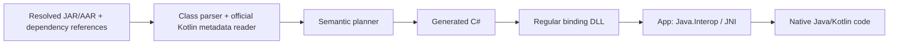

# Android binding workbench

Turn Java and Kotlin libraries into C# APIs for .NET Android apps. This
experimental compiler runs inside an ordinary Android binding project, using
a private NuGet package rather than replacing your installed Android workload.

## Try a small example

You need Git, .NET SDK **11.0.100**, a .NET 10 runtime and **JDK 21**. The sample
also needs an installed .NET 11 Android workload and Android SDK. Set
`JAVA_HOME` and `ANDROID_HOME` to those existing installations.

```sh
dotnet run --project eng/Workbench -- doctor
dotnet run --project eng/Workbench -- bootstrap
dotnet run --project eng/Workbench -- pack
dotnet run --project eng/Workbench -- generate
```

`bootstrap` fetches the pinned upstream source and applies this repository's
local changes. `pack` builds the compiler into `.artifacts/feed/`. `generate`
compiles this [Java sample](samples/hello/Native/Greeter.java):

```java
package com.example.bindingworkbench;

public final class Greeter {
    public static String greet(String name) {
        return "Hello, " + name + "!";
    }
}
```

The generated binding lets C# call it:

```csharp
using HelloBindings;

string? message = Greeter.Greet("team");
```

The command builds the binding and a separate C# consumer under
`.artifacts/hello-dotnet/`. It does not install or run an Android app. Inspect
`Binding/obj/Debug/net11.0-android/semantic-bindings/` there for generated C#,
native API facts and compiler reports.

## Use it in your binding project

Download `Microsoft.Android.BindingGenerator.Semantic.0.1.0-preview.workbench.3.nupkg`
and its matching source/hash provenance from the
[current workbench release](https://github.com/Redth/AndroidBindingsExperiments/releases/tag/workbench-2026-11-16)
into a local NuGet feed. Building with `pack` produces the same package version
in `.artifacts/feed/`; use that run's matching provenance for its exact hashes.
The older `workbench.2` release is historical, not this source snapshot.

For example, put `hello.jar` beside `Hello.Binding.csproj`:

```xml
<Project Sdk="Microsoft.NET.Sdk">
  <PropertyGroup>
    <TargetFramework>net11.0-android</TargetFramework>
    <SupportedOSPlatformVersion>24</SupportedOSPlatformVersion>
    <IsBindingProject>true</IsBindingProject>
    <AndroidBindingGenerator>Semantic</AndroidBindingGenerator>
  </PropertyGroup>
  <ItemGroup>
    <PackageReference Include="Microsoft.Android.BindingGenerator.Semantic"
                      Version="0.1.0-preview.workbench.3"
                      PrivateAssets="all" />
    <AndroidLibrary Include="hello.jar" Bind="true" />
    <AndroidNamespaceReplacement Include="Com.Example.Bindingworkbench"
                                Replacement="HelloBindings" />
  </ItemGroup>
</Project>
```

Build using your local feed plus the ordinary NuGet feed:

```sh
dotnet build Hello.Binding.csproj \
  --source /absolute/path/to/local-feed \
  --source https://api.nuget.org/v3/index.json
```

Reference the binding project from your Android app or class library with a
normal `ProjectReference`. The compiler package is private build tooling; it
does not select the compiler for downstream projects. Set
`AndroidBindingGenerator=Legacy` to use the installed workload's generator.

### Choose the native inputs

`Bind="true"` generates C# APIs. `Bind="false"` supplies a native dependency
without generating another binding for it. `Pack="false"` keeps that native
input out of this project's packaged output; the app must obtain its required
native payload through another deliberate path. These settings are independent.

Normal SDK inputs still apply. For example, instead of a local `AndroidLibrary`:

```xml
<AndroidMavenLibrary Include="de.hdodenhof:circleimageview" Version="3.1.0" />
```

Or build a module from your existing Gradle project:

```xml
<AndroidGradleProject Include="../native/build.gradle.kts"
                      ModuleName="mylibrary" Bind="true" />
```

These are illustrative SDK input forms, not additional fresh integration-test
claims. The compiler consumes the SDK's selected JAR/AAR inputs and references;
it does not add a dependency resolver. Keep one compatible native dependency
graph and avoid generating duplicate bindings for types already owned elsewhere.

## How it works



The parser finds the real JVM types and method signatures. The Kotlin reader
adds source-level information such as nullability, generics and suspend
functions. The planner uses those facts to generate C#, which the normal .NET
build compiles into a DLL. At runtime, Java.Interop/JNI connects that DLL to the
native library in your app.

A **raw peer** is the managed wrapper responsible for a Java object's identity
and callbacks. An optional **generic view** is an ordinary C# API over that
peer, not a second registered owner. Rich views and Kotlin Task/Flow helpers
use the separate `Microsoft.Android.Kotlin` runtime; its native bridge is
source-built in the app's selected Gradle graph.

Choosing a new compiler does not rewrite existing assembly identities, change
native versions or make incompatible APIs interchangeable. Compiled
compatibility profiles are a bounded CLI pilot, not an automatic MAUI MSBuild
switch. See [current capabilities and limits](docs/CURRENT-STATE.md).

## Explore further

Use the [command guide](eng/README.md) for host builds, tests, package inspection
and the full no-device fixture. The [source map](upstream/README.md),
[research/results guide](docs/README.md) and
[current validation](docs/results/workbench-validation.md) explain the deeper
compiler, runtime, ownership and compatibility experiments.

This is a local preview, not a supported product. Current package validation
covers macOS ARM64, .NET 11 and Android workload 37.2.31; it does not certify
every OS, workload revision or native SDK combination.
