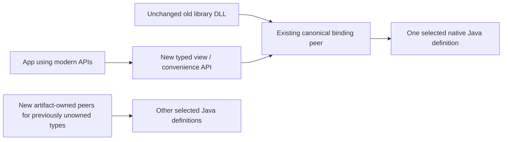

# A smooth .NET 12 binding transition

**Updated direction: support old and new binding generations side by side, then
treat MAUI's public-contract migration as a separate compatibility task.** There
is no fundamental CLR/JNI prohibition on coexistence, including on .NET 11.
Separate CLR identities are constraints at crossing points, not a reason to
require rewriting every old library or to postpone all experimentation until
.NET 12.

Existing libraries can retain their old binding references; new libraries can
use the new bindings. The SDK/runtime must make projection selection, checked
cross-generation conversion and peer/callback lifetime reliable against one
compatible native graph. This is an implementation goal, not a claim that the
complete dual-binding matrix already passes.

When MAUI itself migrates internally, preserve the old public/protected ABI at
its boundaries and offer additive newer APIs. Audit both explicit signatures
and inheritance/inherited contracts. Legacy-owner adoption remains an available
fallback for difficult shared contracts rather than a prerequisite for every
new library.

This is a proposed product/migration plan, not an implemented compatibility
layer. Our generated SDK DLL trees prove useful compiler and JNI behavior; they
are not yet drop-in replacements for the curated Android binding ecosystem.

## 1. Four changes that must not be bundled into one switch

| Change | Compatibility consequence |
| --- | --- |
| Use the semantic/Kotlin compiler internally | Can be compatible if it preserves the required managed and native contracts. |
| Introduce typed views, Task/Flow conveniences and projection constraints | Can be additive while raw APIs remain available. |
| Move/rename raw CLR types or change their member shapes | Breaks existing binaries/source unless compatible contracts, forwarding or adapters address the specific changes. |
| Replace the native dependency graph or remove embedded native payloads | Requires correct dependency, resources, manifest, consumer-rule and native ABI reconciliation. |

“.NET 12 uses the new compiler by default” does not need to mean “.NET 12 replaces
every AndroidX CLR type with an incompatible new type.”

The consumer’s target framework does not rewrite the assembly identities and
method signatures already recorded inside a referenced DLL.

## 2. Coexistence: what can and cannot work unchanged

| Situation | Treatment |
| --- | --- |
| Old bindings and new bindings cover different Java types | Generally feasible, provided the native graph and managed references are compatible. |
| Old bindings own shared types; newly generated code references those exact CLR types | Preferred compatibility model. Existing consumers keep their current identities. |
| New ordinary views wrap old canonical peers | Preferred modernization model; needs imported-owner facade support in the compiler. |
| Old and new precompiled assemblies each own the same Java type | Not a supported default. Matching Java names/handles do not make their CLR types assignable. |
| A compatible CLR type moves assemblies without changing its full name/contract | A forwarding assembly can preserve old consumer references. |
| CLR names, arity, class/interface kind, constructors or method shapes differ | Requires explicit compatible wrappers/aliases, source migration or restricted binary transformation; not just a type forward. |
| Existing Java bytecode expects a class which is now an interface | Requires a compatible native graph, updated native caller or a real native bridge. CLR remapping does not repair that bytecode. |

Some duplicate managed wrappers can physically load, and target-type-aware JNI
lookup can create an alternative wrapper. That is not enough for automatic C#
casts, deterministic peer ownership, correct callbacks, or arbitrary AOT
compatibility. Build validation should classify binding carriers, internal
invokers and user-generated Java wrappers separately.

**Sharing a Java object is useful; pretending two unrelated CLR contracts are
identical is not the migration strategy.**

## 3. Compatibility-first owner selection

For each Java binary type, maintain an explicit selected managed owner:

- The existing Android platform owner, such as `Mono.Android`, remains authoritative.
- An eligible referenced legacy binding can remain the owner of a shared type.
- Types not already owned receive the new per-Maven-artifact owner.
- Modern views and mapped views reference the selected canonical peer; they do
  not register another peer or independently own its lifetime.
- Two competing precompiled owners require a clear compatibility decision or an
  error. Reference enumeration order must not choose the winner.

Record the actual CLR full name, generic arity, class/interface kind, assembly
identity, constructors, managed signatures and relevant JNI registrations. Keep
current native artifact provenance separate from this identity.

For a mixed existing app:



The diagram does not require another managed peer for the same Java object.
Existing subclasses and callback implementations remain tied to their original
carrier and must be tested against the selected native ABI.

### Important limit: app-specific selection cannot rewrite precompiled APIs

If an already compiled `NewLibrary.dll` has a public parameter whose type is in
`NewBindings.dll`, selecting an old owner at the app level does not change that
parameter. The compiled signature still refers to the new owner.

Consequently:

- App/source-generated views can be generated against the owners selected for
  that app’s graph.
- Published libraries exposing vendor binding types must reference a recognized,
  stable managed contract. They cannot let every consuming app invent a different
  owner for those public signatures.
- Libraries wanting private, minimal bindings can expose their own managed
  abstractions or stable peer-level boundaries and use internal views.
- A precompiled library targeting an incompatible owner needs forwarding,
  verified adaptation/relinking or a rebuild.

This distinction is essential for NuGets and project references to coexist
without simply moving the conflict to the final application.

### Alternative worth proving: a .NET 12 dual-binding transition

Both old and new precompiled binding sets could coexist for a transition period
without claiming CLR type equivalence. This is a viable alternative to
legacy-owner adoption, not something ruled out by assembly-qualified identity.
It needs deliberate SDK/runtime support; the current unique-owner validation
and standalone SDK tests do not certify it.

The model is:

```text
old library -> old CLR binding projection \
                                          one selected Java class/object
new library -> new CLR binding projection /
```

Each API generation still has one managed owner for each Java type. The
transition explicitly permits one legacy and one modern projection across the
two generations, instead of treating any arbitrary duplicate as acceptable.

Required work:

- Keep distinct assembly identities and distinguish source-visible names,
  using aliases where needed. Existing source and DLL references retain their
  old identities.
- Package only one coherent native graph. Two managed representations are not
  permission to include incompatible/duplicate native archives.
- Make typed JNI lookup choose/reuse the projection requested by the call site.
  Define a deterministic default for lookups without a target type; never use
  last-discovered ownership as the policy.
- Provide checked cross-generation conversion helpers. They can wrap the same
  Java object without constructing another Java object. They are not ordinary
  CLR casts, and ReferenceEquals across different projections is not guaranteed.
- Verify alias lifetime, reference release, repeated lookup, arrays, callbacks,
  subclasses and Java virtual dispatch. An alias must not replace the original
  managed callback owner or register competing native callback implementations.
- Preserve stable public signatures within each generation while publishers
  migrate. Native ABI incompatibilities remain build errors.

There is a concrete runtime foundation: `PeerIdentityTests` covers requesting
an incompatible managed type while preserving the original registered peer;
the returned typed wrapper refers to the same Java object. That proves the
alias principle, not full old/new AndroidX, package, typemap or NativeAOT support.

A release path could keep both generations supported in .NET 12, move
first-party/new libraries toward the modern contracts, and make modern bindings
the normal path in .NET 13. Retiring the old generator/default packages is
different from refusing to load old binding DLLs. An application containing an
unmigrated library still needs its old CLR contracts or an approved compatible
replacement. Keep an optional compatibility package/path, or declare the
cutoff a breaking change, rather than assuming all third-party dependencies
have migrated merely because the target framework changed.

The next decision should be based on a dual-set pilot using unchanged legacy
consumer DLLs and independently compiled new consumer DLLs, with shared types
crossing both directions under every supported runtime. This pilot should be
compared directly with the simpler adopted-legacy-owner model before choosing
the default migration strategy.

### MAUI compatibility layer and additive APIs

The working target is a list of the old binding contracts reachable through
MAUI's public/protected ABI, followed by explicit compatibility treatment for
each crossing. That list must include base classes, inherited members, generic
arguments/constraints and callback signatures, not just namespace references
inside MAUI source.

For old binaries, keep old signatures and marshal the matching old projection at
the MAUI boundary. Source-level implicit conversions can improve newly compiled
code, but cannot retroactively alter IL or make `is`/`as` tests invoke conversion
operators. Public class hierarchy changes may need preserved legacy bases or
exact-contract forwarding rather than a value adapter.

An additive v2 lifecycle/platform API can expose the modern contracts while
legacy registrations continue through the compatibility dispatcher. Define
event ordering, handled results, base calls, subscription lifetime and object
identity explicitly; do not turn one native notification into duplicate events.

The pinned MAUI lifecycle source already uses Android framework `Activity` and
`Bundle` for the standard Android lifecycle callbacks. Those types have the
shared platform owner. The actual AndroidX-sensitive boundaries also include
public MAUI types inheriting AndroidX classes and callers that cast a framework
Activity to such types; the ongoing public API audit must distinguish them.

The initial source inventory at MAUI commit
`418cecf802289defcdbc17c420fb8e429007dd41` examined 18 Android shipped/unshipped API
files. It found 176 entries directly naming 40 distinct AndroidX/Material type
spellings, concentrated in Core and Controls. Examples include
`StackNavigationManager.NavController`, fragment-manager APIs, Shell's
DrawerLayout/Toolbar signatures and widget extension methods. No matching
lifecycle signature directly names AndroidX.

This is not yet the definitive binary compatibility closure: the source API
text does not enumerate every inherited member/base contract. Source verification
also confirms `MauiAppCompatActivity : AppCompatActivity` and the generic public
`MauiRecyclerView<...> : RecyclerView`, including protected listener members.
Those require hierarchy/override compatibility treatment, not just conversion
of an event argument. The source inventory is preserved in
`maui-compat-audit/androidx-public-api-source-inventory.json`.

The product tasks should be separated: (1) reliable old/new binding coexistence
on the current runtime, and (2) MAUI's internal migration with a stable legacy
public/protected contract plus additive modern APIs. Neither task inherently
requires waiting for .NET 12; retiring old generation defaults later does not
automatically remove an application's old CLR contract dependencies.

### Regenerated-owner pilot, with usage-selected compatibility

The alternative of regenerating protected types under their old owner is now
implemented as a bounded compiler pilot. A compiled MAUI
`11.0.0-rc.2.26505.5` snapshot of all five resolved `Microsoft.Maui*.dll` Android
assemblies exposes 64 distinct AndroidX/Material boundary types. Following the
public/protected contract gives 588 types across 26 binding owners.

The profile separates identity/signature exposure from observed construction,
member calls, subclassing, overrides and interface implementation. It does not
automatically preserve every legacy overload merely because the type occurs in
a parameter. For the selected compiled MAUI/custom consumers, 1,248 contract
entries are pinned instead of the full 10,128. These are compatibility
obligations, not a claim that only that many APIs are generated.

The actual regeneration pilot uses AndroidX SwipeRefreshLayout: its original
owner remains `Xamarin.AndroidX.SwipeRefreshLayout, Version=1.0.0.0`. MAUI and a
custom consumer compiled against the old binding run without recompilation.
The selected profile retains 25 of the class's 61 contract entries plus the
two callback-interface methods; unused old int-to-enum overloads are omitted.
A newly available `InvokeOnMeasure` method works on the same legacy instance.
The full-contract fallback also compiles and passes its larger ABI comparison.

The runtime test exposed an important implicit obligation: legacy
`XAPeerMembers` dispatch uses `ThresholdClass`, `ThresholdType` and
`JniPeerMembers` even without direct IL references. Omitting these for a
subclass path passed the initial structural comparison but failed NativeAOT.
The usage selector now includes those runtime obligations; final checks pass
13/13 in Debug, 13/13 full-trim/R8 and 13/13 NativeAOT on the unmodified stock
.NET 11 Android workload. The generator suite passes 813 tests.

This selective guarantee is scoped to the listed compiled consumers and the
selected native graph. It does not prove that unlisted plugins, reflection or
arbitrary future subclasses do not use omitted members. Such requirements must
be added explicitly or covered by the full profile. The prototype compiler CLI
and compiled verifier are not yet a new public profile property in the earlier
semantic-generator NuGet preview. See
`tests/BindingProjection/MauiCompatibility/README.md` for reproduction.

## 4. The compatibility-facing raw API and modern API can be different

Keep the raw carrier compatible where existing code depends on it. Layer modern
generic, nullable, coroutine and convenience projections over that carrier.

Examples of raw contracts that cannot be reconstructed solely from a JAR:
curated CLR names, enum projections, events/delegates, stream conversions,
handwritten members and historical protected/virtual/interface shapes.
Existing DLLs and curated contracts are compatibility evidence, not just
disposable old generator output.

Use old assemblies unchanged initially. For first-party regenerated bindings,
an explicit **legacy CLR contract profile** can preserve the public/protected
binary surface while the new frontend supplies native/Kotlin facts. Native
requirements from old binaries must survive even when source annotations now
hide a member or the native library retains it only as a synthetic bridge.

### Generic constraints during transition

An old compiled peer does not suddenly implement `IJavaProjection<TPeer>`
because another assembly adds that interface. The current compiler already
falls back to runtime bounds when an imported peer lacks this capability.

Do not require modifying every third-party DLL just to use modern generics.
Offer runtime-checked/mapped views for unchanged legacy owners. First-party
compatibility releases may add projection support where separately verified;
adding a base interface to an existing public interface is not automatically a
safe compatibility change, even if default implementations help.

Modernization should therefore have its own opt-in surface, rather than silently
turning every old raw type into a constrained view.

## 5. Forwarding and rewriting: a narrow ladder, not a universal converter

### First choice: leave consumer DLLs unchanged

If the old carrier still provides the expected CLR contract and the native ABI
is compatible, there is nothing to rewrite. A new view can use that carrier.

### Second choice: exact-contract forwarding and compatibility aliases

Where we control a binding package, we can keep the old assembly identity and
public contract, or replace its type definitions with forwards to compatible
definitions in a new artifact assembly.

A real type forward is for the same CLR full name and generic arity. It is not
a mapping from an arbitrary old class to a differently named modern wrapper.
The forwarded type must still satisfy old constructors, members, inheritance,
interfaces and behavior. Replacing the original assembly requires the expected
assembly identity and signing/version policy.

An intentional ownership move can therefore look like:

```text
unchanged consumer DLL
    -> old-named compatibility assembly
        -> forwarded, same-contract raw type in artifact assembly
            + additive modern views
```

There must not also be a second public peer definition in the compatibility
assembly. JNI connector strings, internal bridge access, callback metadata,
resources and typemap behavior need explicit treatment; forwarding public types
alone is not proof of Android interoperability compatibility.

We do not have to rename raw types just because we want more idiomatic modern
APIs. View names can evolve without moving the underlying peer identity.

### Third choice: source migration

A Roslyn analyzer/code fix can provide reviewed symbol-based changes:
namespace/member aliases, generated view construction, explicit peer boundaries
and supported generic conveniences.

Task/Flow/cancellation, ownership, nullability and default-argument changes are
behavioral changes. They must not become unreviewed search-and-replace rules.
An app’s source can migrate while a referenced third-party DLL stays unchanged.

### Fourth choice: opt-in, verified binary relinking

Build-time rewriting is technically possible, but should initially support
only audited mappings with matching CLR contracts.

It must rewrite and resolve all affected metadata/signatures and IL operands,
not only assembly-reference names. It must also check generated JNI connector
assembly-qualified names, attributes, interface implementations, generic
constraints, fields, constructors, overrides, PDBs and downstream callers.

Write transformed copies into the build output, never mutate restored NuGet
packages or original inputs. Cache using source hashes and the mapping/tool
version; emit a deterministic transformation report.

Do not claim support for arbitrary reflection strings, serialized type names,
vendor-signed assemblies or authenticating/re-signing someone else’s output
without an explicit supported policy.

**Changing `OldRecord` references into `RecordView<T>` is not an identity
retarget.** The latter is a different representation with different
constructors, ownership and signatures. Rebuilding source or retaining an
old-shaped compatibility API is usually the better solution.

Do not base the default on dynamic loading, assembly-load-context tricks or
runtime-generated code. They do not create ordinary CLR type equivalence, and
NativeAOT needs the final program graph determined before compilation.

## 6. One native graph, with a bridge for old packages

Use the existing Gradle/native-graph integration; do not design a second
dependency resolver for this migration.

New binding packages can contain:

- Managed contract/carrier assemblies or reproducible projection inputs.
- The stable owner registry and compatibility profile.
- Native requirements: Maven provenance/version policy and actual JNI
  classes, members, invocation kinds, hierarchy and callback requirements.
- Necessary adapter source and diagnostic information.

They should not contain the vendor JAR/AAR payloads.

Existing NuGets may still embed or ship native archives. The compatibility
bridge must discover and account for those inputs:

1. Prefer publisher-provided native dependency metadata from updated packages.
2. For older packages, use explicit, verified provenance/compatibility mappings
   or retain their exact binary inputs in a compatibility path.
3. Select one coherent native graph and validate the requirements of both
   existing managed/native callers and new projections.
4. Reconcile resources, manifests, native libraries, consumer R8 rules and
   license requirements as well as Java classes.
5. Exclude redundant old payloads only when the chosen replacement is verified.
   Unknown/custom/shaded AARs must not be silently discarded or guessed from a
   filename.

The current `_AndroidUseResolvedNativeGraph` experiment disables sidecar AAR
discovery. It is not by itself a complete migration mechanism for every legacy
package/native payload.

If upstream introduces a genuine incompatible native change, fail before
runtime with the requested caller/slot and conflicting selected version.
“A newer Maven version was selected” is not enough evidence of compatibility.

## 7. Making the development experience usable

The current full-surface SDK experiments are a compiler-validation tool, not a
finished product experience. The usable layer needs:

- An inspectable owner/dependency report explaining what was adopted, generated,
  forwarded or rejected.
- Stable contract packages for precompiled library boundaries; per-artifact
  generation does not mean globally moving types on each native-container move.
- A supported public API and minimum necessary implementation closure.
- Additive modern APIs without forcing users to rewrite existing raw code.
- Cached descriptors and generation keyed by native hashes, managed contract/
  owner identities, projection policy and tool version. No repeated whole-corpus
  work for an ordinary app edit.
- IDE discovery, useful naming/documentation and actionable build diagnostics.
- A defined strategy for selected native-ABI callback/subclass adapters.
- Explicit legacy/adaptive/canonical-only modes during previews. These are
  proposed mode names, not properties already implemented in the SDK.

Adaptive means “preserve compatible referenced contracts while generating new
ones”, not “silently use whichever library happened to be found first.”

## 8. Rollout without a flag day

| Stage | Deliverable | Exit condition |
| --- | --- | --- |
| 1. Mixed-owner pilot | Deterministic legacy owner index, imported-owner views and native payload reconciliation. | A genuinely precompiled old consumer works unchanged alongside a new SDK/API. |
| 2. First-party compatibility packages | Binary-free native requirements plus preserved CLR contracts for the shared AndroidX/Kotlin ecosystem. | Existing MAUI/Toolkit/third-party signatures and callbacks still link and behave correctly. |
| 3. .NET 12 adaptive preview | Modern generation opt-in, owner/native validation, cached builds and clear fallback. | Compatibility/performance matrix passes; unsupported cases fail explicitly. |
| 4. .NET 12 default eligibility | New compiler/adaptive behavior becomes default for proven scenarios; legacy escape remains supported. | No hidden CLR identity migration or reliance on automated rewriting to make common apps build. |
| 5. Optional new-identity migration | Approved forwarders, compatibility aliases, source tools and restricted relinking. | Each supported transition has unchanged-binary and native runtime evidence. |

Canonical-only new raw identities can remain opt-in while the ecosystem
transitions. A “new APIs everywhere” epoch should not be a prerequisite for
making the compiler and packaging improvements useful.

## 9. Next implementation: prove an unchanged old binary

The next experiment should not be another independently regenerated SDK graph.
It should be a **mixed old/new application**:

1. Compile a legacy consumer once against released bindings, with public vendor
   type signatures, protected overrides and a Java callback implementation.
   Preserve its DLL hash and do not rebuild it during the compatibility test.
2. Reference that DLL and its original compatible managed owners from a modern
   application using the existing resolved native graph.
3. Generate modern APIs for a new SDK while adopting shared legacy peers.
   Exercise a shared AndroidX type across the old/new boundary.
4. Implement imported-owner typed views and validate return/argument identity,
   disposal, virtual dispatch and callbacks; leave old peer owners unchanged.
5. Add a separate exact-contract forwarding pilot. Do not conflate it with
   the unchanged-owner pilot.
6. Validate every supported runtime configuration, including full trimming/R8
   and NativeAOT, and prove incompatible graphs are rejected.

Minimum compatibility matrix:

| Scenario | Required result |
| --- | --- |
| Old DLL plus new source/view with shared peers | Original DLL bytes and CLR contracts unchanged; one peer owner. |
| New precompiled DLL exposes a different owner | Explicit compatible forward/adapter or rejection, not implicit adoption. |
| Java class moves Maven containers without changing ABI | CLR owner unchanged; native payload reconciled. |
| Old synthetic native compatibility slot is required | Slot retained in validation even if hidden from the modern source API. |
| C# subclass and managed interface callback | Correct selected-native wrapper and original managed callback identity. |
| Old enum/events/streams/custom managed members | Exact old ABI preserved or a declared source migration. |
| Native class/interface or required descriptor break | Clear pre-runtime diagnostic. |
| Unknown/shaded legacy native archive | No guessed replacement or silent removal. |
| Owner without new generic projection interfaces | Supported runtime-checked/mapped route; no mandatory binary mutation. |
| Cached incremental build | No whole-corpus regeneration; repeatable output and bounded disk growth. |

Only after this matrix passes should default migration policy be committed.

## Evidence behind this recommendation

Verified current-worktree pieces:

- `CodeGenerator.cs`, `AddTypeToTable`: semantic mode reuses an existing imported
  registered peer rather than emitting a duplicate.
- `GenericFacadeProjection.cs`: currently allocates facades only for generated
  public peers. Imported-owner modernization is a real missing implementation.
- `JavaProjectionContract.cs`: imported capability is checked; it is not assumed
  to exist in old DLLs.
- `SymbolTable.cs`: generic lookup can select the last registered symbol;
  production owner conflict resolution must not rely on that order.
- `SharedPeerViewTests.cs` and `SharedPeerViews/`: identity, virtual dispatch,
  callbacks, lifetime and independent plain managed views are explicitly covered.
- `JniRuntime.JniValueManager.cs`: peer lookup is target-type-aware, not a general
  CLR type-equivalence mechanism.
- `TrimmableTypeMapGenerator.cs`: duplicate Java-wrapper validation is scoped to
  generated wrappers; this is not a complete conflicting binding-owner check.
- The per-artifact SDK trees and registry move tests establish useful building
  blocks, not legacy package/MAUI drop-in compatibility.
- `native-api-evolution-research.md` distinguishes native-container moves, CLR
  owner moves/type-forward incidents and actual native ABI breaks.

External references:

1. [Microsoft: CLR type forwarding](https://learn.microsoft.com/en-us/dotnet/standard/assembly/type-forwarding).
2. [Microsoft: library changes and binary compatibility](https://learn.microsoft.com/en-us/dotnet/core/compatibility/library-change-rules).
3. [Microsoft: assembly load contexts and identities](https://learn.microsoft.com/en-us/dotnet/core/dependency-loading/understanding-assemblyloadcontext).
4. [Microsoft: NativeAOT deployment](https://learn.microsoft.com/en-us/dotnet/core/deploying/native-aot/).

**Bottom line:** modernize around a compatible peer contract first. Move type
identities only through an explicit supported migration, and never promise that
matching JNI handles or wholesale IL rewriting makes arbitrary old/new APIs
interchangeable.

## Project-local generator NuGet: implemented local preview

**A build-only NuGet is a practical way to trial the compiler on selected binding
projects without replacing the installed Android workload.** The implemented
preview uses:

```xml
<PropertyGroup>
  <AndroidBindingGenerator>Semantic</AndroidBindingGenerator>
</PropertyGroup>
<ItemGroup>
  <PackageReference Include="Microsoft.Android.BindingGenerator.Semantic"
                    Version="0.1.0-preview.1"
                    PrivateAssets="all" />
</ItemGroup>
```

These names now identify built local preview packages and a package-owned
property. They are not a NuGet.org release or an enabled-by-default workload
feature. Blank or `Legacy` restores the installed SDK's generator.

The baseline SDK already routes `ClassParse` and `BindingsGenerator` through
`_BindingsToolsLocation`, with `ClassParseToolExe` and `BindingsGeneratorToolExe`.
That is useful tool redirection, but not enough on its own: ordinary
`GenerateBindings` receives adjusted XML and the released invocation does not
know the semantic/Kotlin/generic switches. Our frontend needs unadjusted
class-parse input. Its current MSBuild task implementation contains additional
properties that stock workloads do not necessarily have.

### Package boundaries

- `build/*.props` and `build/*.targets`: project-local selection/bootstrap,
  Android/workload capability checks and an explicitly ordered binding-target
  integration. Do not make generator selection flow through `buildTransitive`.
- Private build-tool directory: matched class-parse, generator, dependencies,
  runtime configuration and the packaged official Kotlin/ASM descriptor tool.
  Nothing in this directory is an app runtime dependency.
- A separately named package-owned task, where needed, to invoke the tools
  without depending on unpublished properties of the workload's task assembly.
  Any new task must follow current MT/path/process-environment requirements.
- Optional runtime support is a separate ordinary package reference. Typed
  views/Task/Flow helpers may require `Microsoft.Android.Kotlin`; its managed
  assembly and required source-built native bridge must reach the app. Making
  the compiler private must not accidentally hide this runtime dependency.

Keep the SDK's Java/AAR discovery, reference resolution, C# compilation,
resources, packaging and publish pipeline. Own only the narrow parser/
descriptor/generation seam. Do not replace `Xamarin.Android.Build.Tasks.dll`
or `MonoAndroidToolsDirectory` globally, and do not copy the entire workload
into the compiler package.

The package must import its target implementation after the SDK's binding
targets. Ordinary NuGet `.targets` import order alone must not be assumed:
the examined Android SDK adds its binding imports through
`AfterMicrosoftNETSdkTargets`. The inspected .NET SDK supports a tail import
list. The preview appends its semantic targets there, with .NET 11/Android 37.x
checks. This was verified against stock workload 37.2.0-rc.2.84 on macOS ARM64.
Long term, upstream a supported generator-selection hook to remove the need to
override private target bodies.

The target sequence should parse using packaged tools, extract a cached official
descriptor from bound/reference native inputs, invoke semantic generation on
raw facts, preserve existing transforms/additions, and feed only the selected
generated C# into the existing SDK compilation targets. Disabling the property
must restore the workload's original path without stale sources.

### First preview scope and safeguards

Start with an existing `IsBindingProject` plus ordinary `AndroidLibrary` inputs.
Preserve the project's chosen output assembly name; one-per-Maven-artifact
partitioning is a separate graph/package feature, not a side effect of changing
the compiler.

The switch does not regenerate already compiled dependency NuGets or rewrite
old DLLs. A compiler switch also does not mean binary-equivalent generated
public API: the semantic policy may change names, visibility or projected shapes.
Require an API diff and validate handwritten additions for existing binding
projects; document this separately from legacy/new runtime coexistence.

Gate imports by Android inner builds and the opt-in property. Multi-targeting,
IDE/design-time generation, cancellation, parallel execution and clean/rebuild
must work correctly. Incremental inputs must include both tools and every real
native/reference/metadata input plus feature selection. Avoid whole-corpus
regeneration and never write into NuGet's package cache.

The tooling currently targets .NET 10 and the descriptor setup uses JDK 21.
Check host/runtime/JDK and workload capabilities explicitly. Choose a tested
support matrix rather than advertising every old Xamarin/.NET Android SDK.
Advanced generated callbacks/interop APIs must be available in the target runtime;
a generator package cannot by itself upgrade missing runtime functionality.

The preview now passes 24 package task regressions and the standalone
stock-workload fixture: no-op tool skipping, no-clean toggles/upgrades,
transforms/additions, missing-source recovery, multi-targeting, design-time
compilation, strict MT and downstream runtime/tooling isolation. Actual package
output passes 11 JNI checks in each of Debug, full-trim/R8 and NativeAOT. The
fixture hashes installed workload files before/after and verifies the AOT APK
contains the native application, not the JIT runtime.

One necessary preview safeguard is intentionally conservative: R8 cannot infer
all JNI slots reached only through ordinary views/Kotlin adapters. The package
exports consumer rules retaining public/protected members of locally emitted
peer classes through the SDK's normal binding AAR path. It does not retain the
whole dependency classpath, but finer app-use-aware projection retention remains
future work. No shim or modified workload was needed for these package tests.
